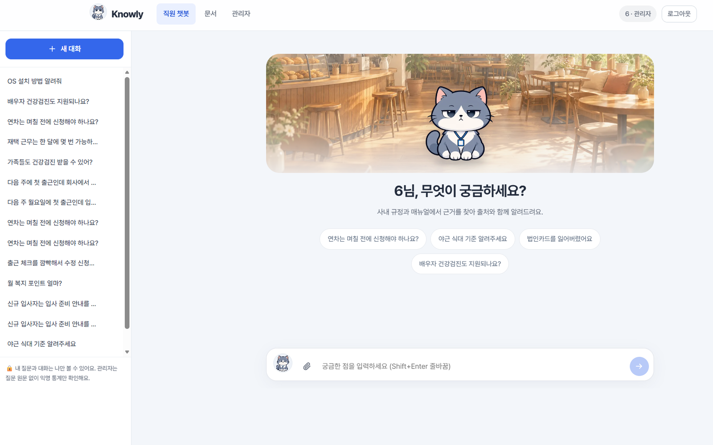
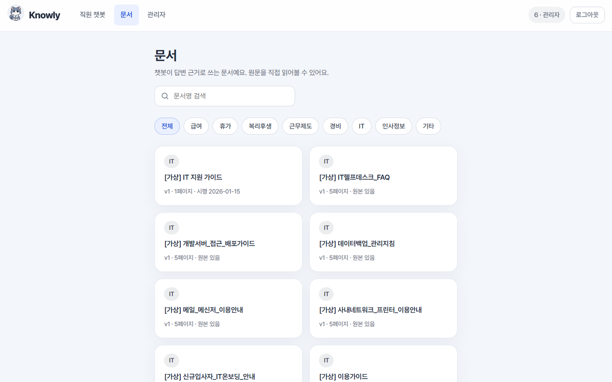
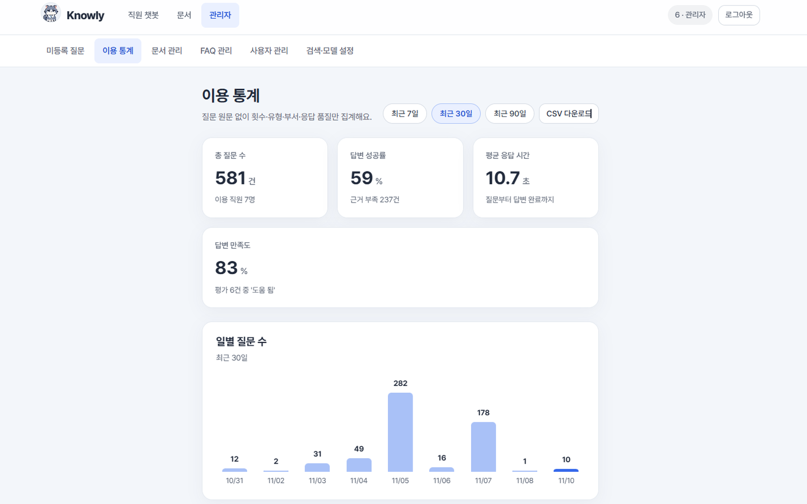

# AX-Project-2 · Knowly

**냥대리 통합 앱:** 루트에서 `npm run dev` / `npm run build`를 실행하면 냥대리 화면에 기존 Knowly 기능이 연결됩니다. 개인 Knowly 계정과 기존 Supabase를 그대로 사용합니다. 게시판·보상을 위한 새 마이그레이션과 `nyang` 함수 배포, 전체 기능 대응표·검증 범위는 **[통합 안내](docs/NYANG_INTEGRATION.md)** 를 확인하세요.

사내 문서를 근거로 답하는 업무 도우미 챗봇입니다. 천안 AX 액션러닝 2조 프로젝트예요.

- **프론트엔드**: React + TypeScript + Vite → Vercel 배포
- **백엔드**: Supabase (Postgres + pgvector, Auth, Storage, Edge Functions)
- **답변 생성**: FAQ 매칭 → 문서 검색(RAG) → OpenRouter LLM 요약 → 출처 검증

> ⚠ Supabase·Vercel·OpenRouter는 외부 클라우드예요. 기업 인터뷰에서 "실제 문서와 질문은 외부로 보내면 안 된다"고 했으므로,
> 이 배포본에는 **가상 문서만** 올려서 시연해 주세요. 사내 운영 전환 방법은 아래 [사내 서버로 옮길 때](#사내-서버로-옮길-때)를 참고하세요.

- **사이트**: https://cheonax-n.duckdns.org (냥대리 디자인)

> [!TIP]
> **사용자 가이드** — 직원·담당자(관리자)의 사용 방법은 **[사용자 가이드 (docs/USER_GUIDE.md)](docs/USER_GUIDE.md)** 에서 확인할 수 있어요.

## 화면 미리보기

<p align="center">
  
  
  
</p>

> **화면별 상세 기능과 사용 방법은 [사용자 가이드](docs/USER_GUIDE.md)에서 확인할 수 있습니다.**

## 기능

| 화면 | 경로 | 내용 |
|---|---|---|
| 로그인 | `/` | 관리자가 발급한 아이디·비밀번호로 로그인 (회원가입 없음). **직원** 탭은 직원 계정, **담당자** 탭은 관리자 계정만 들어가요 |
| 직원 챗봇 | `/` | 대화형 질문, **사진·PDF·엑셀·텍스트 첨부(최대 3개, 붙여넣기·끌어다 놓기)**, 요약·절차·주의사항·상세 설명, 문서명·버전·페이지 출처, 원문 보기, 도움 됨/안 됨, 내 대화 기록 |
| 미등록 질문 | `/admin/unanswered` | 근거를 못 찾았거나 '도움 안 됨'을 받은 질문을 비슷한 것끼리 묶어 보여주고, 바로 FAQ로 등록 |
| 이용 통계 | `/admin/stats` | 질문 수, 이용 직원 수, 성공률, 응답 시간, 만족도, 부서별·카테고리별·모델별 집계, CSV |
| 문서 관리 | `/admin/documents` | PDF·엑셀(XLSX·XLS·CSV)·TXT 업로드(끌어다 놓기 가능) → 브라우저에서 페이지(엑셀은 시트)별 추출 → 청크·(임베딩) → 검색 활성화 |
| 문서 보기 | `/docs`, `/docs/:id` | 텍스트 보기와 원본 보기 (PDF는 앱 안에서 페이지로, 엑셀은 시트별 표로) |
| FAQ 관리 | `/admin/faqs` | FAQ 추가·수정·숨김·삭제 |
| 사용자 관리 | `/admin/users` | 계정 발급, 부서·권한 변경, 비밀번호 재설정 |
| 검색·모델 설정 | `/admin/settings` | 답변 모델 선택·연결 테스트, 검색 기준(키워드·임베딩) 조정, 검색 미리보기 (채팅과 같은 규칙) |

**개인정보 원칙** (기업 인터뷰 반영)
- 질문 원문과 대화는 **본인만** 볼 수 있어요 (RLS로 관리자도 조회 불가).
- 미등록 질문은 이름·아이디 없이 질문 문장만 익명으로 모아요.
- 관리자 통계는 원문 없는 집계 함수(`admin_usage_stats`)로만 조회해요.
- 질문에 첨부한 파일·사진은 **저장하지 않아요**. 그 답변을 만들 때만 쓰고, 대화에는 파일 이름과 읽었는지만 남아요.
  다만 답변을 만들 때 외부 모델(OpenRouter)로 보내지므로 실제 사내 자료는 첨부하지 마세요. 사진 속 주민번호·카드번호 등은 판독할 때 가리도록 지시해요.

> 설계서는 초기 입력을 'PDF와 UTF-8 텍스트'로 정했지만, 팀 요청으로 엑셀 문서 등록과 질문 첨부를 추가했어요 (2026-11-07).

## 무엇을 물어볼 수 있나요

Knowly는 **관리자가 등록한 사내 문서와 FAQ에 있는 내용**만 답해요. 문서에 근거가 없으면 지어내지 않고
"등록된 답변 없음"으로 알려 주고, 그 질문은 이름 없이 담당자에게 전달돼 FAQ 보강에 쓰여요.

지금 시연용으로 등록된 가상 문서는 `[가상] 휴가·근태 규정`, `[가상] 급여·복리후생 안내`, `[가상] 출장·경비 정산 매뉴얼`,
`[가상] IT 지원 가이드` 4개와 FAQ 3개예요 (`supabase/seed.sql`). 아래 예시는 이 문서로 답할 수 있는 질문이에요.

| 분야 | 예시 질문 |
|---|---|
| 휴가 | 연차는 며칠 전에 신청해야 하나요? · 오후 반차는 몇 시부터예요? · 배우자 출산 휴가는 며칠인가요? |
| 급여 | 급여일이 언제예요? · 급여일이 휴일이면 언제 받나요? |
| 복리후생 | 건강검진 비용도 지원되나요? · 자기계발비는 얼마까지 지원되나요? |
| 근무제도 | 기본 근무 시간이 어떻게 되나요? · 점심시간은 몇 시예요? |
| 경비 | 야근 식대 기준 알려주세요 · 법인카드를 잃어버렸어요 · 출장 경비는 언제까지 정산해야 하나요? |
| IT | 노트북 교체 주기가 어떻게 되나요? · 계정이 잠겼어요 |
| 인사정보 | 재직증명서는 어디서 발급해요? · 경력증명서도 출력할 수 있나요? |

**이런 질문은 답하지 못해요**
- 등록된 문서에 없는 내용 (예: 시연 문서에는 재택근무·육아휴직·퇴직연금 규정이 없어요 → 미등록 질문으로 모여요)
- 개인 상황 조회 (예: "내 남은 연차가 며칠이에요?") — 인사시스템 데이터와 연결되어 있지 않아요
- 사내 규정과 관계없는 일반 질문

**잘 묻는 요령**
- "휴가"보다 "연차는 며칠 전에 신청해야 하나요?"처럼 상황을 넣어 구체적으로 물어보세요.
- 한 번에 한 가지씩 물어보면 더 정확하게 찾아요. 존댓말·인사가 붙어도 핵심 질문을 뽑아서 찾아요.
- 답변 아래 출처를 누르면 문서 원문을 바로 확인할 수 있어요.

> 문서를 더 등록하면 물어볼 수 있는 범위도 늘어나요. 답을 못 찾는 질문이 많으면 관리자 화면의
> **미등록 질문**에서 FAQ로 등록하거나, **검색·모델 설정**에서 검색 기준을 조정해 보세요.
> 자세한 사용법은 [사용자 가이드](docs/USER_GUIDE.md)를 참고하세요.

## 폴더 구조

```
src/                        React 앱
  pages/Chat.tsx            직원 챗봇 (질문 첨부 포함)
  pages/DocumentList.tsx    문서 목록 (/docs)
  pages/DocumentView.tsx    문서 보기 (/docs/:id): 텍스트 · 원본 PDF · 원본 표
  pages/admin/*             관리자 화면 (Settings.tsx: 모델·검색 기준·검색 미리보기)
  components/PdfViewer.tsx  원본 PDF를 앱 안에서 그림 (pdf.js, 보이는 페이지만)
  components/SheetViewer.tsx 원본 엑셀을 시트별 표로 보여 줌
  lib/pdf.ts                pdf.js 불러오기 (호환 빌드 + 한글 CMap)
  lib/extract.ts            PDF 페이지별·엑셀 시트별·텍스트 추출, 실제 파일 형식 검사
  lib/sheet.ts              엑셀 시트 → 검색용 텍스트, 시트/페이지 표시
  lib/attach.ts             질문 첨부 준비 (파일 글자 추출, 사진 줄이기, 스캔 PDF → 사진)
supabase/
  migrations/               DB 스키마, RLS, 검색·통계 함수, 관리자 설정
  seed.sql                  가상 문서·FAQ·예시 미등록 질문
  functions/chat            질문 처리 (첨부 읽기 → 질문 정리 → FAQ → 검색 → LLM → 출처 검증 → 저장·집계)
  functions/ingest          문서 청크 분할·임베딩, 재색인
  functions/admin-users     계정 발급·삭제·비밀번호 재설정
  functions/admin-settings  모델·검색 기준 저장, 모델 연결 테스트, 검색 미리보기
  functions/_shared         검색어 추출·점수, 청크 분할, 프롬프트, 모델 어댑터(LLM·임베딩·사진 판독)
tests/                      검색·청크·첨부·출력 검증 단위 테스트
docs/USER_GUIDE.md          직원·담당자용 사용자 가이드
docs/tests/                 검색 품질 진단 보고서, VDI 2차 테스트 질문지(정답표 포함)
.github/workflows/          자동 배포 (프론트엔드 → Vercel, 백엔드 → Supabase)
vite.config.ts              pdf.js 글꼴 자료(CMap 등)를 /pdfjs/ 로 함께 배포
```

## 처음 설정하기

### 1. Supabase DB 만들기

[Supabase 대시보드](https://supabase.com/dashboard) → 프로젝트 → **SQL Editor**에서 순서대로 실행해요.

1. `supabase/migrations/20261031000000_init.sql` 전체 붙여넣고 실행
2. `supabase/migrations/20261103000000_app_settings.sql` 실행 (관리자 설정 표, 검색 함수 갱신)
3. `supabase/seed.sql` 실행 (가상 문서 4개, FAQ 3개, 예시 미등록 질문)

CLI를 쓴다면:

```bash
npx supabase login
npx supabase link --project-ref <project-ref>
npx supabase db push
```

### 2. 회원가입 막기

**Authentication → Sign In / Providers → Email**에서 **Allow new users to sign up**을 끕니다.
(계정은 관리자 화면에서만 발급해요.)

### 3. 첫 관리자 계정

1. **Authentication → Users → Add user → Create new user**
   - Email: `admin@knowly.local` (로그인 아이디는 `@` 앞부분인 `admin`)
   - Password: 8자 이상, **Auto Confirm User** 체크
2. SQL Editor에서 관리자 권한 부여:
   ```sql
   update public.profiles set role = 'admin', display_name = '관리자' where login_id = 'admin';
   ```

이후 직원 계정은 사이트의 **관리자 → 사용자 관리**에서 만들면 돼요.

### 4. Edge Functions 배포와 비밀값

main에 push하면 자동으로 배포돼요 ([자동 배포](#자동-배포-github-actions)). 직접 배포하려면:

```bash
npx supabase functions deploy chat
npx supabase functions deploy ingest
npx supabase functions deploy admin-users
npx supabase functions deploy admin-settings

# LLM (없으면 '검색 전용' 모드로 문서 내용을 그대로 보여줘요)
npx supabase secrets set LLM_API_KEY=<OpenRouter 키> LLM_MODEL=openai/gpt-6-luna
```

| 비밀값 | 기본값 | 설명 |
|---|---|---|
| `LLM_API_KEY` | (없음) | OpenRouter API 키. 없으면 검색 전용 모드 |
| `LLM_BASE_URL` | `https://openrouter.ai/api/v1` | OpenAI 호환 API 주소 |
| `LLM_MODEL` | `openai/gpt-6-luna` | 모델 ID. 관리자 → 설정에서 고른 모델이 있으면 그것이 우선이에요 (2026-11-07 운영 모델을 Qwen에서 Luna로 변경) |
| `LLM_TEMPERATURE` / `LLM_MAX_TOKENS` | `0.2` / `2000` | 추론 설정. 추론형 모델은 생각하는 토큰도 `LLM_MAX_TOKENS`에 들어가므로 700처럼 작게 두면 답이 잘려요 |
| `LLM_REASONING_EFFORT` | `low` | OpenRouter 추론 강도 (`low`·`medium`·`high`, `off`면 보내지 않음). 생각 과정은 응답에서 빼요 |
| `EMBEDDING_MODEL` | (없음) | 지정하면 벡터 검색을 함께 사용. 없으면 키워드 검색만 |
| `EMBEDDING_BASE_URL` / `EMBEDDING_API_KEY` | LLM 값 사용 | 임베딩 API 주소·키 |
| `VISION_MODEL` | OpenRouter 사용 시 `google/gemini-2.5-flash-lite` | 질문에 첨부한 사진을 읽는 모델. OpenRouter가 아니고 지정도 없으면 사진은 읽지 않아요 |
| `ALLOWED_ORIGIN` | `*` | CORS 허용 출처. 배포 후 Vercel 주소로 좁히세요 |

> API 키는 Supabase secret에만 넣고, 저장소나 프론트엔드 환경변수에는 넣지 마세요.
> 임베딩 모델을 바꾸면 기존 문서는 재색인해야 벡터 검색에 포함돼요. 화면 버튼은 아직 없어서,
> 관리자 로그인 토큰으로 `ingest` 함수에 `{"action":"reindex"}`를 보내요 (실패하면 어느 문서에서 막혔는지 알려 줘요).
> 임베딩 API가 429·5xx를 내면 1초·2초 간격으로 최대 3번 다시 보내요.

### 5. 로컬 실행

필요한 프로그램: **Node.js 22**, npm 10 (자동 배포도 Node 22를 써요)

```bash
cp .env.example .env.local   # VITE_SUPABASE_URL, VITE_SUPABASE_PUBLISHABLE_KEY 입력
npm install
npm run dev                  # http://localhost:5173
npm test                     # 단위 테스트
npm run build                # 타입 검사 + 빌드
```

### 6. Vercel 배포

1. [Vercel](https://vercel.com/new) → **Import Git Repository** → `AX-Project-2`
2. Framework Preset: **Vite** (자동 인식), Root Directory: 그대로
3. Environment Variables:
   - `VITE_SUPABASE_URL` = `https://<project-ref>.supabase.co`
   - `VITE_SUPABASE_PUBLISHABLE_KEY` = `sb_publishable_...`
4. Deploy. `vercel.json`이 새로고침 시 404가 나지 않도록 모든 경로를 `index.html`로 보내요.

## 답변이 만들어지는 순서

1. 로그인 토큰으로 사용자·부서 확인, 질문 길이 검사 (2,000자)
2. 질문을 세 모양으로 준비: 원래 질문 / 부연 설명을 뺀 실제 질문 문장 / AI가 인사·배경·높임말을 걷고 규정 용어로 정리한 질문
   (15자 미만 질문은 AI 정리를 건너뛰고, 실패해도 나머지로 진행). 검색어를 뽑을 때 높임·격식 어미(-시-, -습니까, -주시겠어요 등)는 뗀다
   → 핵심 검색어끼리 비교해 등록된 FAQ와 같은 질문이면 FAQ 답변 반환
3. 문서 청크 검색: 한국어 바이그램 키워드 점수 (+ 임베딩이 있으면 코사인 유사도)로 후보 8개를 뽑고,
   키워드 점수를 "맞은 검색어 ÷ min(검색어 수, 6)"으로 보정해 다시 정렬한 뒤 기준을 넘은 앞의 5개를 근거로 써요
   (관리자 → 설정의 검색 미리보기도 같은 규칙. 구어체 어미 조각은 검색어에서 빼요)
4. 근거가 기준 미달이면 **답하지 않고** "등록된 답변 없음" → 미등록 질문으로 익명 수집.
   문서는 찾았지만 질문에 딱 맞는 기준이 없으면 "딱 맞는 기준 없음"으로 가장 가까운 내용과 관련 출처를 보여 줌.
   문서 숫자로 바로 계산되는 질문(주 2일 → 한 달 기준)은 계산 과정과 "문서에 직접 기준은 없음"을 밝혀 답함
5. 근거 조각에 `[S1]` 같은 ID를 붙여 LLM에 전달, JSON 형식으로 요약·절차·주의사항·출처 ID를 받음
6. 서버가 JSON 형식과 출처 ID를 검사 (허용 목록 밖 ID는 버림, 형식 오류는 1회 재요청)
7. 대화 저장(본인만 열람), 통계 이벤트 저장(원문 없음)

## 운영할 때 확인할 것

- **답변 모델**: 관리자 → 설정에 모델이 정해져 있으면 그것이 우선이에요. 운영 모델은 `openai/gpt-6-luna`예요.
  Supabase 비밀값에 `LLM_MAX_TOKENS=700`처럼 작은 값이 남아 있으면 Luna 답이 잘려 폴백되니 지우거나 2000으로 올려 주세요.
- **문서 재등록**: 2026-11-07에 청크 나누기(절 제목이 바뀔 때 앞 절 내용을 붙이지 않음)를 고쳤어요.
  이미 등록된 문서에는 적용되지 않으므로, 구버전 정리와 함께 문서를 다시 올려 주세요.
- **검색 기준 맞추기**: 관리자 → 설정 → 검색 미리보기에서 질문을 넣으면 질문을 어떻게 정리했는지(원래 질문·질문 문장·AI 정리),
  각 조각이 '사용 / 순위 밖 / 제외' 중 무엇인지 보여요. 채팅과 같은 규칙이에요.
- **응답 시간**: 15자 이상 질문은 AI 질문 정리가 먼저 돌아 1~3초 더 걸려요. 사진 첨부는 판독 시간이 더 들어요.
- **품질 측정**: `docs/tests/`의 질문지로 다시 측정할 때는 [테스트 정보](모델·top-k·임베딩)를 꼭 채우고,
  한 번에 설정 하나만 바꾸고, 문항마다 새 대화로 3회씩 돌려 주세요.

### 지원 범위와 한계

| 항목 | 내용 |
|---|---|
| 문서 등록 | PDF, 엑셀(XLSX·XLS·CSV), TXT·MD, 20MB 이하. 시트 하나 = 한 페이지 |
| 질문 첨부 | 사진(JPG·PNG·WebP·GIF), PDF, 엑셀, 텍스트. 최대 3개, 개당 10MB. 사진은 1600px로 줄여 보내요 |
| 스캔 PDF | 문서 등록은 아직 안 돼요(글자 없음). 질문 첨부는 첫 페이지를 사진처럼 판독해요 |
| 텍스트 인코딩 | UTF-8과 CP949(EUC-KR) 모두 읽어요 |
| 원본 표 보기 | 시트마다 앞 500행까지. 나머지는 '원본 파일 받기'로 확인 |
| 지원 안 함 | Word(.docx)·한글(.hwp), 암호 걸린 엑셀 |

## 변경 이력

### 2026-11-07

| 구분 | 내용 |
|---|---|
| 배포 | 냥대리 디자인을 `main`으로 합침. `main` push → cheonax-n(`knowly-nyang`) 자동 배포, 기존 사이트(cheonax)는 배포 중단 |
| 배포 | 백엔드 자동 배포의 Supabase CLI 옵션 수정(`--remote` → `--project-ref`). 첫 실행 성공 |
| 문서 보기 | 문서 목록·문서 보기 화면, 관리자 문서 관리의 '보기' 버튼, 답변 출처의 '문서 전체 보기' |
| PDF | 한국어 표준 글꼴(HYGoThic 등) PDF에서 글자가 비어 나오던 문제 수정(CMap). 원본 PDF를 앱 안에서 그려 휴대폰에서도 보임, 출처 페이지로 이동. 오래된 브라우저용 호환 빌드 |
| 엑셀 | XLSX·XLS·CSV 등록, '머리글: 값' 형태로 검색, 원본 표 보기, 출처에 '시트 N' 표시 |
| 첨부 | 질문할 때 사진·파일 첨부. 첨부는 저장하지 않음. 사진은 판독 모델(`VISION_MODEL`)로 글자·설명을 읽음 |
| 검색 | 진단 보고서 반영: 키워드 점수 보정(긴 질문 불이익 제거), 구어체 어미 조각 제거, 절 경계 청크 수정, 채팅·미리보기 같은 규칙(후보 8 → 근거 5) |
| 검색 | 존댓말·부연 설명이 붙은 질문: 높임 어미 제거, 질문 문장 뽑기, AI 질문 정리, 세 모양으로 검색해 합침, FAQ는 핵심어끼리 비교 |
| 답변 | 운영 모델을 `openai/gpt-6-luna`로. 추론 토큰 때문에 답이 잘리지 않도록 `max_tokens` 2000, 추론은 짧게. 주→월 같은 간단한 계산 허용, '딱 맞는 기준 없음' 표시 |
| 자료 | `docs/tests/`에 검색 품질 진단 보고서와 VDI 2차 테스트 질문지 추가 |

### 2026-11-03 ~ 11-05

| 날짜 | 구분 | 내용 |
|---|---|---|
| 11-03 | 관리자 | 검색·모델 설정 화면: 답변 모델 선택·연결 테스트, 검색 기준 조정, 검색 미리보기 |
| 11-03 | 검색 | 자연스러운 말투의 질문도 찾도록 검색어 추출 개선 |
| 11-03 | 문서 보기 | 등록된 문서를 직원이 직접 읽는 문서 목록·문서 보기 화면 |
| 11-04 | 디자인 | 냥대리 프로토타입 디자인과 로그인 화면 적용, 탭별 계정 유형으로만 로그인 |
| 11-05 | 검색 | 등록된 문서를 현재 임베딩 모델로 다시 색인하는 `reindex`, 임베딩 호출 재시도 |
| 11-05 | 배포 | GitHub push → Vercel·Supabase 자동 배포 (GitHub Actions) |

### 2026-10-31

- Knowly 첫 버전: 로그인, 직원 챗봇(FAQ → 문서 검색 → LLM 요약 → 출처 검증), 미등록 질문, 이용 통계, 문서·FAQ·사용자 관리

## 사내 서버로 옮길 때

모델 호출은 OpenAI 호환 API만 쓰기 때문에 주소와 모델만 바꾸면 돼요.

```bash
# 예: 사내 Ollama
LLM_BASE_URL=http://<내부 서버>:11434/v1
LLM_MODEL=qwen3:1.7b
LLM_API_KEY=            # 비워 둠
VISION_MODEL=qwen2.5vl:7b   # 사진 첨부를 읽을 모델 (없으면 사진은 읽지 않음)
EMBEDDING_BASE_URL=http://<내부 서버>:11434/v1
EMBEDDING_MODEL=bge-m3
```

Supabase도 self-hosting이 가능하지만, 기존 사내 PostgreSQL을 쓰려면 `supabase/migrations`의 스키마와
`supabase/functions`의 로직을 사내 백엔드로 옮겨야 해요. 같은 설정이라도 하드웨어·양자화에 따라 품질과 속도가
달라질 수 있으니, 가상 평가 질문으로 다시 검증해 주세요.

## 참고 자료

- `Knowly_개발설계서_v1.docx`: 요구사항 F01–F07, API·DB 설계
- `docs/tests/Knowly_검색품질_진단보고서_원인및개선방안.pdf`: QA 문서 25문항 1~3차 결과, 실패 원인(C1~C8), 개선 로드맵
- `docs/tests/틸론_챗봇2차테스트_질문지_VDI_15문항_IT팀.xlsx`: 모호 질문 15문항 + 답 없음 3문항, 정답표
- FAQ 챗봇 관리자 대시보드 프로토타입: 미등록 질문 화면과 직원 챗봇 피드백 흐름
- 노션 `AX 기업 과제 프로젝트 2조`: 기업 인터뷰, 기술 멘토링, 발표 피드백

## 자동 배포 (GitHub Actions)

GitHub에 push하면 자동으로 배포돼요. 별도 명령은 필요 없어요.

| push한 브랜치 | 배포되는 곳 |
|---|---|
| `main` | 냥대리 디자인 https://cheonax-n.duckdns.org (Vercel `knowly-nyang`) |
| `main`의 `supabase/` 변경 | DB 변경(migration) + Edge Function |

- 기존 디자인 사이트 https://cheonax.duckdns.org (Vercel `knowly`)는 더 이상 자동 배포하지 않아요. 마지막 배포 상태 그대로 남아 있어요.
- 진행 상황과 실패 원인은 GitHub 저장소의 **Actions** 탭에서 볼 수 있어요.
- 단위 테스트가 실패하면 배포하지 않아요.
- 기능은 자기 브랜치에서 고치고, GitHub에서 PR을 만들어 `main`에 합치면 배포돼요.
- DB 변경은 되돌리기 어려워요. `supabase/migrations/`에 새 파일을 추가하기 전에 팀과 꼭 상의해 주세요.
- 저장소 비밀값 `VERCEL_TOKEN`, `SUPABASE_ACCESS_TOKEN`이 필요해요 (Settings → Secrets and variables → Actions).
- 백엔드는 `supabase/` 폴더가 바뀔 때만 자동으로 돌아요. 배포 설정만 고쳤거나 다시 배포하고 싶으면
  **Actions → Deploy backend → Run workflow**를 눌러요.
- DB 변경은 미리 보기 단계(dry-run) 다음에 바로 적용돼요. 사람이 확인하는 단계가 없으니 PR 리뷰에서 꼭 확인해 주세요.
