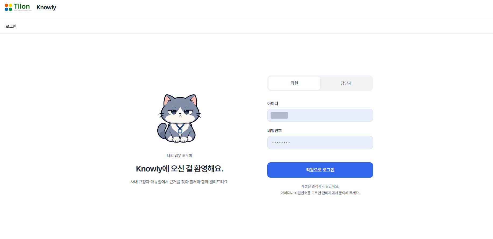
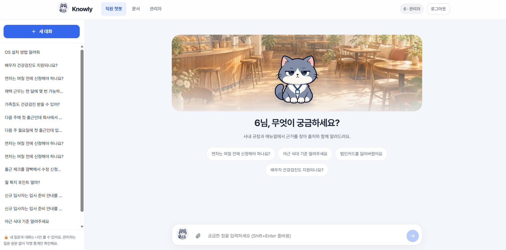
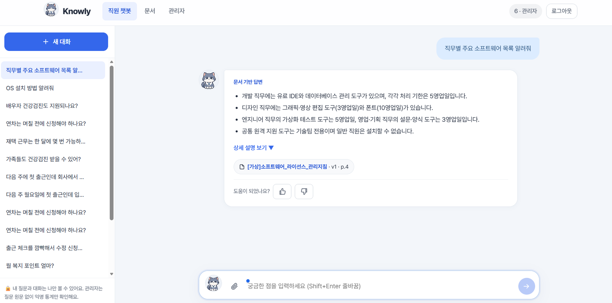
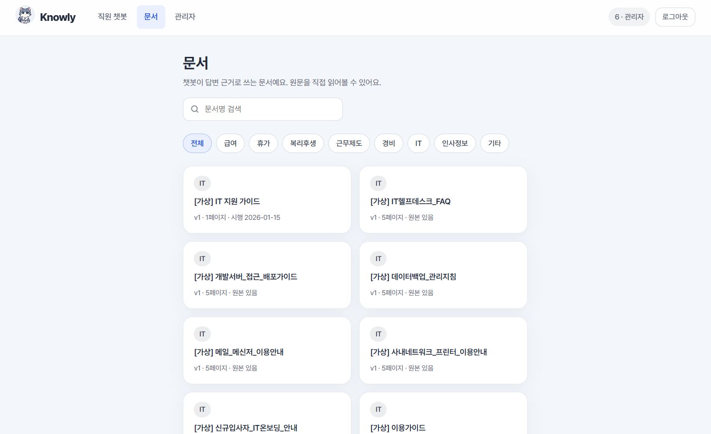
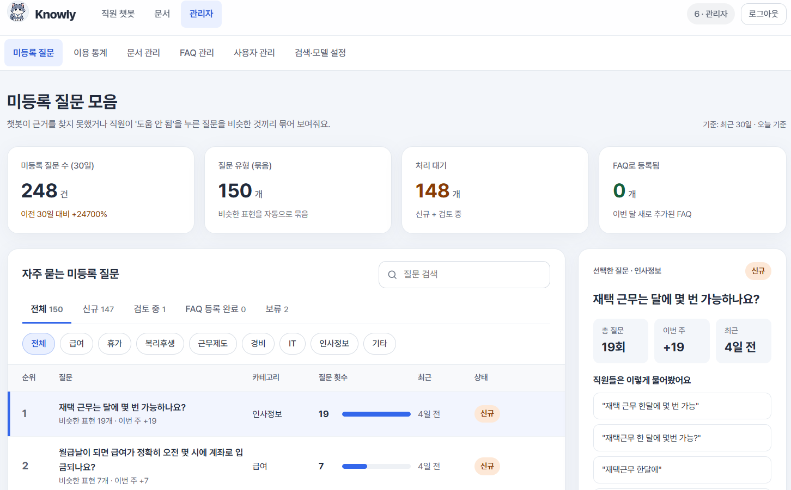
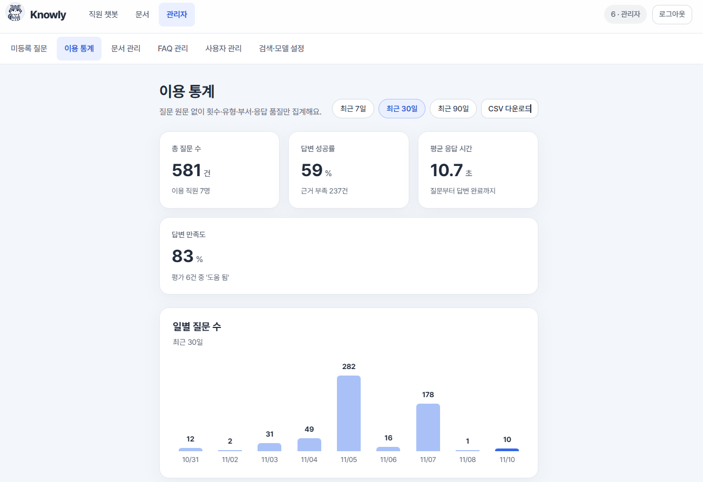
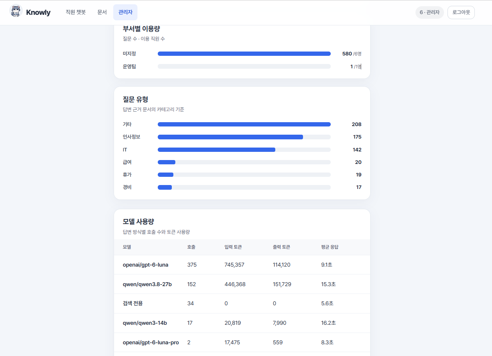
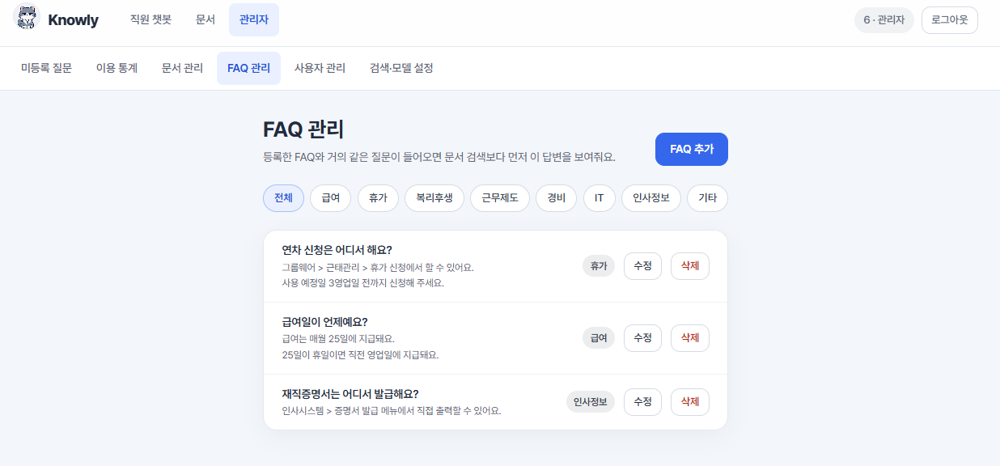
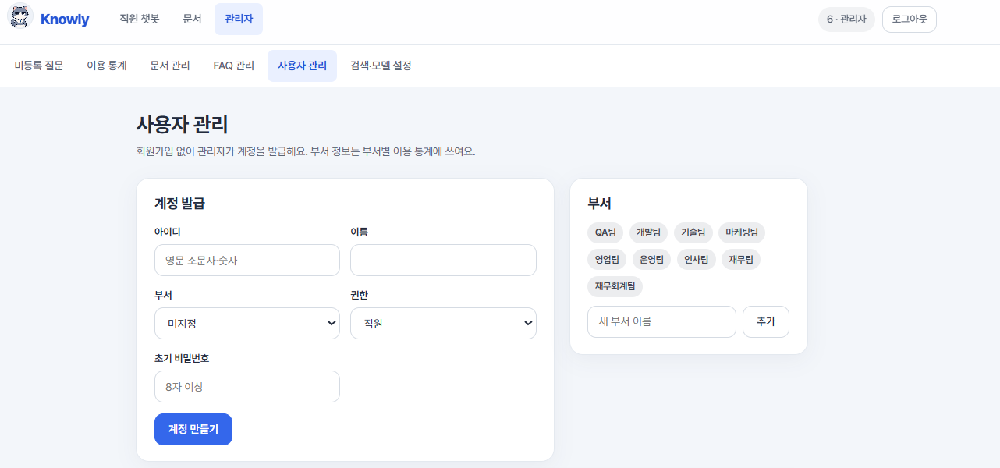

# Knowly 사용자 가이드

Knowly(냥대리)는 회사 규정과 매뉴얼을 찾아서 **출처와 함께** 답해 주는 업무 도우미예요.
이 문서는 사이트를 쓰는 **직원**과 문서·FAQ·계정을 관리하는 **담당자(관리자)**를 위한 안내서예요.

- 사이트 주소: https://cheonax-n.duckdns.org
- 계정은 담당자가 만들어 줘요. 회원가입은 없어요.

> ⚠ 지금 사이트는 외부 클라우드(Supabase·OpenRouter)에서 돌아가는 **시연용**이에요.
> 실제 사내 문서나 개인정보가 든 파일은 올리거나 첨부하지 마세요. 가상 문서로만 테스트해 주세요.

## 목차

| 누가 | 볼 곳 |
|---|---|
| 모두 | [1. 로그인](#1-로그인) |
| 직원 | [2. 챗봇에 질문하기](#2-직원-챗봇에-질문하기) · [3. 문서 직접 보기](#3-직원-문서-직접-보기) |
| 담당자 | [4. 관리자 화면](#4-담당자-관리자-화면): [미등록 질문](#4-1-미등록-질문--faq로-등록) · [이용 통계](#4-2-이용-통계) · [문서 관리](#4-3-문서-관리-문서-올리기) · [FAQ 관리](#4-4-faq-관리) · [사용자 관리](#4-5-사용자-관리) · [검색·모델 설정](#4-6-검색모델-설정) |
| 모두 | [5. 자주 묻는 질문](#5-자주-묻는-질문) |

---

## 1. 로그인

1. 사이트에 들어가면 로그인 화면이 나와요.
2. 위쪽 탭에서 계정 유형을 골라요.
   - **직원**: 챗봇으로 질문하는 일반 직원
   - **담당자**: 문서·FAQ·계정을 관리하는 관리자
3. 받은 **아이디**와 **비밀번호**를 넣고 **직원으로 로그인**(담당자 탭에서는 담당자로 로그인)을 눌러요.

| 이런 메시지가 나오면 | 이렇게 해요 |
|---|---|
| "담당자 계정이에요. 담당자 탭에서 로그인해 주세요." | 위쪽 탭을 **담당자**로 바꿔요 |
| "담당자 계정이 아니에요. 직원 탭에서 로그인해 주세요." | 위쪽 탭을 **직원**으로 바꿔요 |
| 아이디·비밀번호가 틀렸다는 메시지 | 담당자에게 비밀번호 재설정을 요청해요 |

---

## 2. 직원: 챗봇에 질문하기

| 화면 위치 | 하는 일 |
|---|---|
| 위쪽 메뉴 | **직원 챗봇** · **문서** (담당자 계정이면 **관리자**도 보여요), 오른쪽에 내 이름과 **로그아웃** |
| 왼쪽 | **+ 새 대화** 버튼과 지난 대화 목록(대화 기록) |
| 가운데 | 처음 화면의 **추천 질문** |
| 아래 | 질문 입력칸, 📎 첨부 버튼, 보내기 버튼 |

### 질문하기

1. 아래 입력칸에 궁금한 점을 적고 **Enter**를 눌러요. 줄을 바꾸려면 **Shift + Enter**.
2. 처음 화면의 **추천 질문**을 눌러도 바로 질문돼요. 위쪽 **카테고리**(휴가 · 급여 · 경비 · IT 등)를 고르면
   그 분야의 추천 질문과 **연관 검색어**가 나와요. 연관 검색어를 누르면 입력칸에 채워지니 뒤에 궁금한 점을 이어 쓰세요.
3. 질문은 한 번에 2,000자까지 쓸 수 있어요.

처음이라면 첫 화면의 **처음이신가요? 이렇게 물어보세요**를 눌러 물어볼 수 있는 범위와 질문 요령을 확인하세요.

평소 말투로 물어봐도 괜찮아요. "안녕하세요, 이번에 입사했는데요, 반차는 어떻게 쓰나요?"처럼
인사나 앞뒤 설명이 붙거나 존댓말로 물어도 핵심 질문을 뽑아서 찾아요.

### 답변 읽는 법

*가상 문서 `[가상]소프트웨어_라이선스_관리지침`을 근거로 한 답변이에요.*

답변 위쪽에 어떤 답인지 표시돼요.

| 표시 | 뜻 |
|---|---|
| **FAQ 답변** | 담당자가 미리 등록한 답이에요 |
| **문서 기반 답변** | 등록된 문서에서 근거를 찾아 정리한 답이에요 |
| **딱 맞는 기준 없음** | 관련 문서는 있지만 질문에 꼭 맞는 기준은 없어요. 가장 가까운 내용을 보여 줘요 |
| **문서 내용이 서로 달라요** | 문서끼리 내용이 달라요. 출처를 직접 확인하고 담당 부서에 물어봐 주세요 |
| **등록된 답변 없음** | 근거를 찾지 못해 답하지 않았어요. 질문은 이름 없이 담당자에게 전달돼요 |

답변은 위에서 아래로 이렇게 나와요.

1. **요약**: 핵심 답을 짧게
2. **절차**: 따라 할 순서
3. **주의사항**: 주황색 상자 안의 경고
4. **상세 설명 보기 ▼**: 눌러서 더 자세한 설명 펼치기
5. **출처**: 문서명·버전·페이지(엑셀은 시트). 누르면 원문을 볼 수 있고, **문서 전체 보기**로 그 문서를 열 수 있어요.

- "주 2일이면 한 달에 며칠?"처럼 문서 숫자로 바로 계산되는 질문은 계산 과정과 함께
  "문서에 직접 기준은 없음"을 밝혀 답해요.

> Knowly는 등록된 문서에 없는 내용은 지어내지 않아요. 중요한 결정은 꼭 출처 원문을 확인해 주세요.

### 도움이 되었나요?

답변 아래 👍(도움이 됐어요) / 👎(도움이 안 됐어요)를 눌러 주세요. **도움 안 됨**을 누르면 그 질문이 이름 없이 담당자에게 전달돼서
FAQ를 보강하는 데 쓰여요.

### 사진·파일 첨부하기

입력칸 옆의 📎 첨부 버튼을 누르거나, 파일을 입력칸에 **끌어다 놓거나**, 캡처한 사진을 **붙여넣기(Ctrl+V)** 하면 돼요.
첨부한 파일 이름은 내 질문 위에 표시돼요.

| 항목 | 내용 |
|---|---|
| 첨부할 수 있는 것 | 사진(JPG·PNG·WebP·GIF), PDF, 엑셀(XLSX·XLS·CSV), 텍스트 |
| 개수·크기 | 한 번에 최대 3개, 파일 하나에 10MB까지 |
| 질문 없이 첨부만 | "첨부한 자료와 관련된 사내 규정이나 절차를 알려 주세요."로 질문돼요 |
| 스캔한 PDF | 첫 페이지를 사진처럼 읽어요 |

- 첨부한 파일은 **저장하지 않아요**. 이번 답변에만 쓰고, 대화에는 파일 이름과 읽었는지 여부만 남아요.
- 파일 옆에 **못 읽음**이 뜨면 내용을 읽지 못한 거예요. 다른 형식으로 바꾸거나 내용을 직접 적어 주세요.
- 현재 테스트 버전은 외부 AI API를 사용하므로, 개인정보나 기밀정보가 포함된 파일은 업로드하지 마세요. 기업 내부 서버에 구축하는 최종 운영 버전의 데이터 처리 방식은 별도 배포 설정에 따라 달라집니다.

### 대화 기록

- 왼쪽 **대화 기록** 목록에서 지난 대화를 다시 열 수 있어요. 새로 시작하려면 **+ 새 대화**를 눌러요.
- 휴대폰처럼 화면이 좁으면 목록이 접혀 있어요. **대화 기록** 버튼을 눌러 열어요.
- 대화를 삭제하면 되돌릴 수 없어요.
- 🔒 내 질문과 대화는 **나만** 볼 수 있어요. 담당자도 원문을 볼 수 없고, 질문 원문 없는 통계만 확인해요.

---

## 3. 직원: 문서 직접 보기

위쪽 메뉴의 **문서**를 누르면 챗봇이 답변 근거로 쓰는 문서 목록이 나와요.

- **문서명 검색**으로 찾거나, 카테고리 버튼(전체·급여·휴가·복리후생·근무제도·경비·IT·인사정보·기타)으로 걸러 볼 수 있어요.
- 문서 카드에는 버전·페이지 수와 시행일 또는 **원본 있음** 여부가 나와요.
- 문서를 열면 보기 방식을 고를 수 있어요.
  - **텍스트**: 페이지(시트)별로 뽑아 낸 글자. 왼쪽 **목차**로 이동해요.
  - **원본 PDF**: 원래 PDF 모양 그대로. 휴대폰에서도 보여요.
  - **원본 표**: 엑셀을 시트별 표로 보여 줘요. 시트마다 앞 500행까지 보이고, 나머지는 **원본 파일 받기**로 확인해요.

---

## 4. 담당자: 관리자 화면

> 이 장은 **담당자(관리자) 계정**에서만 보이는 화면이에요. 직원은 [5. 자주 묻는 질문](#5-자주-묻는-질문)으로 넘어가도 돼요.

**담당자** 탭으로 로그인한 뒤 위쪽 메뉴의 **관리자**를 누르면 관리자 화면이 열려요.
그 아래 줄의 메뉴는 이렇게 구성돼 있어요.

| 메뉴 | 하는 일 |
|---|---|
| 미등록 질문 | 답을 못 했거나 '도움 안 됨'을 받은 질문을 모아 보고 FAQ로 등록 |
| 이용 통계 | 질문 수, 이용 직원 수, 성공률, 만족도 등 확인 |
| 문서 관리 | 문서 등록·검색 제외·삭제 |
| FAQ 관리 | FAQ 추가·수정·숨김·삭제 |
| 사용자 관리 | 계정 발급, 부서·권한 변경, 비밀번호 재설정 |
| 검색·모델 설정 | 답변 AI 모델과 검색 기준 조정, 검색 미리보기 |

담당자 계정으로도 위쪽 **직원 챗봇** 메뉴에서 질문해 볼 수 있어요.

### 4-1. 미등록 질문 → FAQ로 등록

1. **미등록 질문**에서 비슷한 표현끼리 자동으로 묶인 질문을 봐요. 이름·아이디는 남지 않아요.
   - 위쪽 카드: 최근 30일 미등록 질문 수, 질문 유형(묶음) 수, 처리 대기, 이번 달 FAQ로 등록된 수
   - 상태 탭(**전체 · 신규 · 검토 중 · FAQ 등록 완료 · 보류**)과 카테고리 버튼으로 걸러 봐요.
2. 목록에서 질문을 누르면 오른쪽에 총 질문 횟수와 **직원들은 이렇게 물어봤어요**(실제 표현들)가 나와요.
3. 자주 나온 질문은 **FAQ로 등록하기**를 눌러 답변을 적고 **등록하기**를 누르면 직원 챗봇에 바로 반영돼요.
4. 당장 답하기 어려우면 **검토 중으로 표시**하거나 **보류**로 옮겨 두세요.

### 4-2. 이용 통계

- 기간(**최근 7일 · 최근 30일 · 최근 90일**)을 골라 총 질문 수, 이용 직원 수, 답변 성공률, 평균 응답 시간, 만족도를 봐요.
- 부서별·카테고리별·모델별(호출 수, 토큰 사용량) 집계와 일별 추이가 나와요.
- **CSV 다운로드**로 엑셀에서 열 수 있어요.
- 질문 원문은 통계에 들어가지 않아요.

| 항목 | 보는 법 |
|---|---|
| 부서별 이용량 | 부서마다 질문 수 / 이용 직원 수. 부서를 정하지 않은 계정은 **미지정**으로 모여요 |
| 질문 유형 | 답변 근거로 쓴 문서의 카테고리 기준이에요 |
| 모델 사용량 | 답변 방식(모델)별 호출 수, 입력·출력 토큰, 평균 응답 시간. **검색 전용**은 AI 요약 없이 답한 경우예요 |

### 4-3. 문서 관리: 문서 올리기

<!-- TODO(캡처 교체): 가상 문서로 다시 찍은 문서 관리 화면

-->

1. **문서 관리 → 새 문서 등록**에서 **파일 선택**을 눌러 파일을 골라요.
2. 문서명(비우면 파일 이름), 카테고리, 버전, 시행일을 넣고 **등록하기**를 눌러요.
3. "텍스트 추출 중… → 원본 저장 중… → 처리 중…"을 거쳐 상태가 **검색 가능**이 되면 바로 챗봇 답변에 쓰여요.

| 항목 | 내용 |
|---|---|
| 올릴 수 있는 파일 | PDF, 엑셀(XLSX·XLS·CSV), 텍스트(TXT·MD), 20MB 이하 |
| 엑셀 | 시트 하나를 한 페이지로 다뤄요. 출처에 '시트 N'으로 표시돼요 |
| 텍스트 인코딩 | UTF-8과 CP949(EUC-KR) 모두 읽어요 |
| 안 되는 것 | 스캔 PDF(글자가 없는 PDF), Word(.docx), 한글(.hwp), 암호 걸린 엑셀 |

등록된 문서 목록에는 카테고리·버전·페이지 수·임베딩 모델과 상태가 나오고, 오른쪽 버튼으로 관리해요.

- **보기**: 직원과 같은 문서 보기 화면을 열어요.
- **검색 제외**: 문서를 지우지 않고 챗봇 답변에서만 빼요. **다시 사용**으로 되돌릴 수 있어요.
- **삭제**: 문서를 완전히 지워요.
- 규정이 바뀌면 새 버전을 올리고, 옛 버전은 **검색 제외**하거나 삭제해 주세요. 두 버전이 함께 있으면
  "문서 내용이 서로 달라요"가 뜰 수 있어요.

### 4-4. FAQ 관리

- 등록한 FAQ와 거의 같은 질문이 들어오면 문서 검색보다 **먼저** FAQ 답변이 나가요.
- **FAQ 추가**로 새 FAQ를 만들고, 목록의 **수정**·**삭제**로 관리해요. 카테고리 버튼으로 걸러 볼 수 있어요.
- **숨김**은 지우지 않고 잠시 내리는 기능이에요. **수정**에서 **챗봇에서 사용** 체크를 끄면 목록에 **숨김** 표시가 붙어요.
- 문서 내용이 바뀌면 관련 FAQ도 함께 고쳐 주세요. FAQ가 먼저 나가기 때문에 옛 답이 계속 보일 수 있어요.

### 4-5. 사용자 관리

*캡처에서는 개인정보 보호를 위해 아래쪽 계정 목록을 뺐어요. 실제 화면에는 양식 아래에 계정 목록이 나와요.*

1. **계정 발급**에서 아이디(영문 소문자·숫자), 이름, 부서, 권한(직원/관리자), 초기 비밀번호(8자 이상)를 넣고 **계정 만들기**를 눌러요.
2. 만든 아이디와 비밀번호를 직원에게 따로 전달해요.
3. 아래 계정 목록에서 계정마다 부서·권한을 바로 바꿀 수 있어요.
4. 비밀번호를 잊었다고 하면 **비밀번호 변경**으로 새 비밀번호를 정해 줘요.
5. **삭제**하면 그 직원의 대화 기록도 함께 지워져요. 내 계정은 삭제할 수 없어요.
6. 부서는 부서별 이용 통계에 쓰여요. 오른쪽 **부서** 목록에 없으면 **새 부서 이름**에 넣고 **추가**해요.

### 4-6. 검색·모델 설정

저장하면 **다음 질문부터** 적용돼요. 저장하기 전에 바꾼 값을 취소하려면 **되돌리기**를 눌러요.

- **답변 모델**: 답을 쓰는 AI 모델이에요. 비워 두면 기본 모델(`openai/gpt-6-luna`)을 써요.
  모델을 바꾼 뒤에는 **이 모델로 테스트**로 연결이 되는지 먼저 확인해요.
- **검색 기준**: 높이면 정확한 근거만 쓰고, 낮추면 더 많은 질문에 답하지만 엉뚱한 근거가 섞일 수 있어요.
- **검색 미리보기**: 질문을 넣으면 질문을 어떻게 정리했는지(원래 질문 · 질문 문장 · AI 정리)와
  각 문서 조각이 **사용 / 순위 밖 / 제외** 중 어디에 들어가는지 보여 줘요. 채팅과 같은 규칙이에요.
  "직원이 물었는데 답을 못 했다"는 질문을 여기에 넣어 보면 원인을 찾기 쉬워요.

> "LLM_API_KEY 비밀값이 없어서 지금은 검색 전용으로 답해요"가 보이면 AI 요약 없이 문서 내용을 그대로 보여 주는 상태예요.
> 개발 담당자에게 알려 주세요.

---

## 5. 자주 묻는 질문

**Q. 분명 문서에 있는 내용인데 "등록된 답변 없음"이 나와요.**
문서에 쓰인 용어로 다시 물어보세요(예: "쉬는 날" → "휴가", "반나절" → "반차").
담당자는 **검색·모델 설정 → 검색 미리보기**에 그 질문을 넣어 어떤 조각이 걸리는지 확인하고, 필요하면 FAQ로 등록해 주세요.

**Q. 답이 예전 규정 기준으로 나와요.**
옛 버전 문서가 아직 **검색 가능** 상태이거나, 옛 내용의 FAQ가 남아 있을 수 있어요. 담당자에게 알려 주세요.

**Q. 답변이 오래 걸려요.**
긴 질문은 AI가 질문을 한 번 정리한 뒤 찾기 때문에 1~3초 더 걸려요. 사진을 첨부하면 사진을 읽는 시간이 더 들어요.

**Q. 내가 한 질문을 관리자가 볼 수 있나요?**
아니요. 대화는 본인만 볼 수 있어요. 답을 못 했거나 '도움 안 됨'을 누른 질문만 **이름 없이** 질문 문장만 담당자에게 전달돼요.

**Q. 휴대폰에서도 쓸 수 있나요?**
네. 챗봇과 문서 보기(원본 PDF 포함) 모두 휴대폰 브라우저에서 열려요.

---

설치·배포·운영 방법은 저장소의 [README](../README.md)를 참고하세요.
